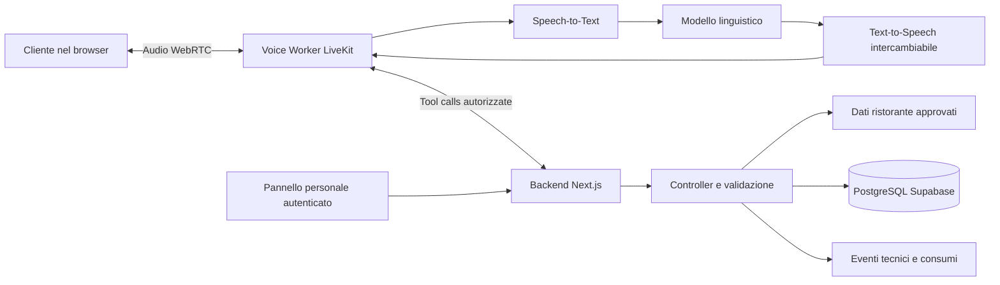

# Architettura proposta

Stato: scheletro Next.js/TypeScript con endpoint di sola lettura e un harness deterministico con proposte di tool allowlistate e revisioni. **Nessun LLM, audio, tool HTTP per agenti, autenticazione o salvataggio è implementato.** La pipeline vocale descritta sotto è una proposta.

## Componenti e confini

Nella proposta modulare il worker vocale invia richieste strumenti al backend con identità di sessione verificata. Il browser non deve poter eleggere privilegi né autorizzare scritture. Ogni input proveniente dal browser o dal modello è non attendibile: il backend verifica sessione, argomenti, versione della richiesta e permessi. La disponibilità mostrata non riserva un tavolo.

Per il browser si propone WebRTC tramite LiveKit; identità di sessione e token temporanei saranno emessi dal backend. Le chiavi permanenti rimangono sul server/worker. La scelta è motivata nella [ADR-001](ADR-001-VOICE-PIPELINE.md).

## Responsabilità

| Componente | Fa | Non può decidere |
| --- | --- | --- |
| Worker vocale + STT/LLM/TTS | Trascrive, conversa, pronuncia e propone strumenti | Permessi, capienza, successo della scrittura |
| Browser | Microfono, audio, stato e inoltro messaggi | Conferme arbitrarie affidabili o accesso DB privilegiato |
| Backend/controller | Valida, conserva lo stato, lega conferma e bozza, limita consumi | Aggirare i vincoli DB per soddisfare il modello |
| Database | Transazioni, unicità, assegnazione tavolo/turno | Interpretare il linguaggio del cliente |
| Pannello | Consulta prenotazioni ed errori dopo autorizzazione | Eseguire comandi pronunciati dal chiamante |

## Stack e decisioni iniziali

| Area | Proposta | Motivazione |
| --- | --- | --- |
| UI e backend | Next.js + TypeScript, una sola applicazione | Riduce servizi da gestire nel laboratorio |
| Voce | LiveKit Agents + STT/LLM/TTS intercambiabili (proposta) | Confrontare sintesi open source, controllare la latenza e isolare i problemi |
| Orchestrazione | Controller applicativo con quattro strumenti | Regole esplicite e verificabili |
| Persistenza | Supabase PostgreSQL | Vincoli e operazioni atomiche sulle prenotazioni |
| Input | Zod più vincoli DB | Controllo di forma e integrità persistente |
| Test | Vitest, Playwright e prove DB concorrenti | Separare logica, browser e integrità |
| Dati del locale | File versionato e validato | Contenuti approvati senza ricerca esterna nella prima versione |

LiveKit Agents è il framework candidato per il worker vocale, da verificare in fase A. Il controller di dominio rimane indipendente dai framework e non sposta i controlli nei prompt. Niente database vettoriale o più agenti in questa fase.

La pipeline a componenti separati è descritta nella [documentazione LiveKit](https://docs.livekit.io/agents/models/pipelines/). Realtime rimane una baseline da confrontare sullo stesso benchmark, non una dipendenza già adottata. Il modello STT, LLM e TTS definitivo sarà scelto solo dopo misure di qualità, latenza e costo.

## Flusso di prenotazione

1. Il backend apre una sessione demo autorizzata e limitata; non espone segreti permanenti.
2. Il controller raccoglie una bozza e incrementa `revision` a ogni variazione di data, ora, coperti o nome.
3. `check_availability` restituisce opzioni riferite alla revisione corrente. Risposte tardive per revisioni precedenti vengono scartate.
4. L'agente riepiloga tutti i dettagli. La conferma viene legata alla bozza corrente dal controller, con una scadenza proposta di due minuti.
5. `create_reservation` verifica la conferma e tenta una transazione: sceglie un tavolo idoneo, protegge la disponibilità concorrente e salva una sola prenotazione.
6. Una conferma valida non garantisce il tavolo: se nel frattempo è occupato, il backend restituisce conflitto e si riparte da una nuova verifica e conferma.
7. Il modello può annunciare il successo solo dopo un risultato `confirmed` con identificativo persistito.

Stati ed errori sono definiti nei [contratti](CONTRATTI_E_DATI.md). Gli stessi controlli si applicano alle chiamate HTTP dirette, senza affidarsi al comportamento corretto del modello.

## Errori e disconnessioni

- Microfono negato o connessione fallita: messaggio testuale, chiusura delle risorse e riavvio esplicito.
- Interruzione mentre l'agente parla: interrompere l'audio; una scrittura già avviata va riconciliata, non considerata annullata.
- Timeout di salvataggio: cercare l'esito usando la stessa chiave idempotente. Fino alla riconciliazione, esito sconosciuto e nessuna nuova prenotazione sostitutiva.
- Servizio non disponibile: nessuna disponibilità inventata e nessuna conferma; proporre richiesta al personale.
- Sessione chiusa: fermare microfono e connessione, invalidare bozze non confermate. Le prenotazioni già persistite restano valide.

## Accessi e distribuzione

All'inizio l'app gira localmente con dati fittizi. Prima di una demo accessibile in rete servono autenticazione dell'accesso demo, limiti per sessione e autorizzazione del pannello. Il chiamante non accede direttamente alle tabelle delle prenotazioni.

Le chiavi segrete Supabase restano sul server. Sulle tabelle negli schemi esposti si applicano RLS e permessi minimi; l'uso di una chiave privilegiata richiede controlli applicativi espliciti perché può bypassare RLS. Riferimento: [Supabase Row Level Security](https://supabase.com/docs/guides/database/postgres/row-level-security).

La telefonia non modifica le regole di prenotazione: aggiungerà un canale al controller esistente, dopo il collaudo. Hosting, provider SIP e modalità di trasferimento reale restano decisioni della fase D.
