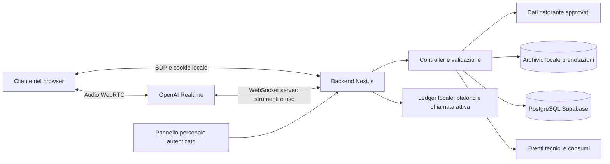

# Architettura proposta

Stato: app locale con disponibilità, OpenAI Realtime e [prenotazioni su disco](PRENOTAZIONI_LOCALI.md). Sessione, conferme, scritture e contatori sono governati dal backend. Il nuovo percorso è verificato offline; il collaudo vocale completo resta aperto. Autenticazione per hosting, database condiviso e pannello restano futuri. Configurazione e limiti in [VOCE_REALTIME.md](VOCE_REALTIME.md).

## Componenti e confini

Realtime invia richieste strumenti sul canale server autenticato; il controller conserva lo stato e verifica schema, revisione e permessi. Il browser non può eleggere privilegi né autorizzare scritture. La disponibilità mostrata non riserva un tavolo. Database e pannello nel diagramma rimangono componenti futuri.

Il browser usa WebRTC tramite lo scambio SDP unificato; chiave permanente e configurazione restano sul server. Un cookie HttpOnly identifica il proprietario della chiamata locale per stato e stop. La proposta LiveKit nella [ADR-001](ADR-001-VOICE-PIPELINE.md) resta uno studio futuro.

## Responsabilità

| Componente | Fa | Non può decidere |
| --- | --- | --- |
| OpenAI Realtime | Comprende audio, conversa, pronuncia e propone strumenti | Permessi, capienza, successo della scrittura |
| Browser | Microfono, audio, stato e inoltro messaggi | Conferme arbitrarie affidabili o accesso DB privilegiato |
| Backend/controller | Valida, conserva lo stato, lega conferma e bozza, limita consumi | Aggirare i vincoli DB per soddisfare il modello |
| Database | Transazioni, unicità, assegnazione tavolo/turno | Interpretare il linguaggio del cliente |
| Pannello | Consulta prenotazioni ed errori dopo autorizzazione | Eseguire comandi pronunciati dal chiamante |

## Stack e decisioni iniziali

| Area | Proposta | Motivazione |
| --- | --- | --- |
| UI e backend | Next.js + TypeScript, una sola applicazione | Riduce servizi da gestire nel laboratorio |
| Voce | OpenAI Realtime via WebRTC; `ws` sul server | Prima conversazione con controllo server di strumenti e consumi |
| Orchestrazione | Controller applicativo con quattro strumenti | Regole esplicite e verificabili |
| Persistenza | Supabase PostgreSQL | Vincoli e operazioni atomiche sulle prenotazioni |
| Input | Zod più vincoli DB | Controllo di forma e integrità persistente |
| Test | Vitest, Playwright e prove DB concorrenti | Separare logica, browser e integrità |
| Dati del locale | File versionato e validato | Contenuti approvati senza ricerca esterna nella prima versione |

Il controller di dominio rimane indipendente dai framework e non sposta i controlli nei prompt. Niente database vettoriale, worker LiveKit o più agenti in questa fase.

La configurazione usa `gpt-realtime-2.1-mini` con voce `marin`, output fino a 1.024 token, VAD semantico e trascrizione input per legare la conferma al turno effettivo. Il confronto futuro con STT–LLM–TTS resta soggetto allo stesso benchmark.

## Flusso di prenotazione

1. Il backend apre una sessione demo autorizzata e limitata; non espone segreti permanenti.
2. Il controller raccoglie una bozza e incrementa `revision` a ogni variazione di data, ora, coperti o nome.
3. `check_availability` restituisce opzioni riferite alla revisione corrente. Risposte tardive per revisioni precedenti vengono scartate.
4. L'agente riepiloga tutti i dettagli. La conferma viene legata alla bozza corrente dal controller, con una scadenza proposta di due minuti.
5. `create_reservation` verifica la conferma e tenta una transazione: sceglie un tavolo idoneo, protegge la disponibilità concorrente e salva una sola prenotazione.
6. Una conferma valida non garantisce il tavolo: se nel frattempo è occupato, il backend restituisce conflitto e si riparte da una nuova verifica e conferma.
7. Il modello può annunciare il successo solo dopo un risultato `confirmed` con identificativo persistito.

Stati ed errori sono definiti nei [contratti](CONTRATTI_E_DATI.md). Gli stessi controlli si applicano alle chiamate HTTP dirette, senza affidarsi al comportamento corretto del modello.

## Errori e disconnessioni

- Microfono negato o connessione fallita: messaggio testuale, chiusura delle risorse e riavvio esplicito.
- Interruzione mentre l'agente parla: interrompere l'audio; una scrittura già avviata va riconciliata, non considerata annullata.
- Timeout di salvataggio: cercare l'esito usando la stessa chiave idempotente. Fino alla riconciliazione, esito sconosciuto e nessuna nuova prenotazione sostitutiva.
- Servizio non disponibile: nessuna disponibilità inventata e nessuna conferma; proporre richiesta al personale.
- Sessione chiusa: fermare microfono e connessione, invalidare bozze non confermate. Le prenotazioni già persistite restano valide.

## Accessi e distribuzione

All'inizio l'app gira localmente con dati fittizi. Prima di una demo accessibile in rete servono autenticazione dell'accesso demo, limiti per sessione e autorizzazione del pannello. Il chiamante non accede direttamente alle tabelle delle prenotazioni.

Le chiavi segrete Supabase restano sul server. Sulle tabelle negli schemi esposti si applicano RLS e permessi minimi; l'uso di una chiave privilegiata richiede controlli applicativi espliciti perché può bypassare RLS. Riferimento: [Supabase Row Level Security](https://supabase.com/docs/guides/database/postgres/row-level-security).

La telefonia non modifica le regole di prenotazione: aggiungerà un canale al controller esistente, dopo il collaudo. Hosting, provider SIP e modalità di trasferimento reale restano decisioni della fase D.
