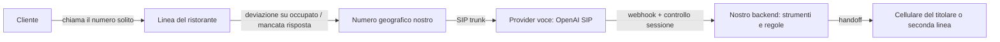

# Voce e telefonia — confronto e scelta

Data: 19 novembre 2026. I prezzi provengono in gran parte da fonti di terze parti e cambiano spesso: vanno verificati sulle pagine ufficiali e sulla console prima di fissare un listino. Sono stime, non preventivi.

## 1. Le tre architetture possibili

| Architettura | Esempi | Pro | Contro |
| --- | --- | --- | --- |
| **Speech-to-speech** (un solo modello ascolta e parla) | OpenAI `gpt-realtime-2.1` / `-mini`, Gemini 3.8 Live | Latenza più bassa, interruzioni naturali, costo basso, SIP nativo (OpenAI) | Meno controllo su voce e pronuncia; il modello decide quando ha "capito" |
| **Piattaforma gestita** | ElevenLabs Agents, Vapi, Retell | Si va in produzione in fretta, voci italiane migliori (ElevenLabs), telefonia inclusa | Costo al minuto più alto, lock-in, regole e dati vivono dentro la piattaforma |
| **Pipeline STT → LLM → TTS** | Deepgram Voice Agent, oppure Pipecat / LiveKit Agents assemblati | Massimo controllo: scegli ogni pezzo, puoi cambiare LLM o voce | Più ingegneria, più punti di latenza da ottimizzare |

## 2. Costi indicativi della sola voce

| Opzione | Prezzo listino | Costo reale stimato al minuto di chiamata |
| --- | --- | --- |
| OpenAI `gpt-realtime-2.1-mini` | $10 / $20 per 1M token audio in/out | ~$0,02–0,05 |
| OpenAI `gpt-realtime-2.1` | $32 / $64 per 1M token audio in/out | ~$0,05–0,15 |
| Gemini 3.8 Live | $3 / $12 per 1M token audio in/out | ~$0,02–0,04 (stima: ~$0,005 ascolto + ~$0,018 parlato, più contesto) |
| ElevenLabs Realtime v1 Max | $0,08/min audio + $1,80 / $9 per 1M token (listino ufficiale, vedi VOICE_BENCHMARK.md) | ~$0,09–0,12 |
| Deepgram Voice Agent | $0,075/min (Standard) | ~$0,08–0,10 con TTS a parte |

Il costo reale nei modelli a token sale durante la chiamata, perché a ogni turno viene rimandato il contesto precedente. Per questo conviene tenere il prompt corto, attivare la cache e chiudere le chiamate lunghe.

**Ordine di grandezza per un locale:** una telefonata di prenotazione dura circa 1,5–2 minuti. Con il modello mini e la telefonia si spendono circa **€0,08–0,12 a chiamata**: 300 chiamate al mese fanno circa **€25–35** di costi vivi. Con il modello flagship o una piattaforma si arriva a circa €0,20–0,30 a chiamata.

## 3. Raccomandazione sulla voce

Le scelte operative e l'ordine delle prove sono in [VOCE_REALTIME.md](VOCE_REALTIME.md) e [VOICE_BENCHMARK.md](VOICE_BENCHMARK.md). Questo documento aggiunge il punto di vista economico e la parte telefonica.

1. **OpenAI Realtime, con `gpt-realtime-2.1` come predefinito e `-mini` per il confronto economico.** È la configurazione attuale. La prima prova reale con il mini ha dato una qualità vocale insufficiente, quindi il costo più basso del mini va giustificato dagli stessi scenari, non dato per scontato. Gli strumenti girano già lato server (canale WebSocket di controllo sulla stessa chiamata), cioè lo schema che serve anche per il telefono.
2. **Alternative nell'ordine del benchmark:** prima ElevenLabs Realtime v1 Max (0,08 USD/min di audio più 1,80/9 USD per milione di token secondo il listino ufficiale), poi Gemini 3.8 Live, che sulla carta costa meno. Si misurano sugli stessi scenari di `evals/` e con i pesi del benchmark.
3. **Il costo per chiamata conta per il listino che farai ai clienti:** con il flagship sono circa €0,20–0,30 a chiamata, non €0,08–0,12. Se il mini o Gemini raggiungono la stessa percentuale di prenotazioni corrette, il margine cambia molto.
4. **Decidi in base ai numeri, non alle impressioni.** Per ogni provider misura sugli stessi scenari:
   - percentuale di prenotazioni corrette
   - errori su date, orari e nomi italiani
   - latenza p50/p95
   - costo per chiamata

Da non prendere per ora: Vapi/Retell come base del prodotto. Sposterebbero le regole di prenotazione dentro una piattaforma terza, cioè l'opposto di quanto fissato in ARCHITETTURA.md.

## 4. Telefonia in Italia

### Come arriva la chiamata all'agente

- **Non far cambiare numero al locale e non chiedere la portabilità.** Il locale imposta una **deviazione di chiamata** verso un nostro numero. È reversibile in un minuto e il ristoratore non rischia nulla.
- **Modalità consigliata per iniziare: "trabocco".** L'agente risponde solo se nessuno risponde entro N squilli o se la linea è occupata. Si vende meglio ("non perdi più chiamate durante il servizio") e il rischio è minore.
- **Codici di deviazione:** quelli GSM standard (`**61*numero#` mancata risposta, `**67*numero#` occupato, `##002#` per disattivare tutto) valgono sui cellulari. Sulle linee fisse TIM e di altri operatori i codici cambiano a seconda della tecnologia (si trovano anche `*22*` / `*23*`), e alcuni operatori fanno pagare la deviazione. **Va verificato operatore per operatore** e conviene prepararne una guida per l'onboarding.
- **Attenzione al loop dell'handoff:** se la linea del ristorante devia verso l'agente, l'agente non può ritrasferire la chiamata **allo stesso numero**, perché la chiamata tornerebbe all'agente. L'handoff deve andare al cellulare del titolare o a una seconda linea, da raccogliere nella config del locale (`agent.json`).

### Da chi prendere i numeri

| Provider | Numeri italiani | Integrazione con OpenAI | Note |
| --- | --- | --- | --- |
| **Twilio** | Geografici con pratica: indirizzo **nel distretto del prefisso**, documenti, codice fiscale/P.IVA | Guida ufficiale Elastic SIP Trunking → OpenAI SIP; in alternativa Media Streams via WebSocket | Il più documentato; prezzi in USD da verificare in console |
| **Telnyx** | Geografici da ~$1–2/mese; stessi vincoli di indirizzo locale e documenti, non self-service | SIP trunk diretto | Più economico; meno guide per OpenAI |
| **Operatori italiani** (Messagenet, Vianova…) | Geografici facili da ottenere, fattura in euro, supporto italiano | Il trunk richiede **registrazione SIP**: serve un intermediario (LiveKit SIP, Asterisk/FreeSWITCH) | ~€15–25/mese per canale; più lavoro tecnico |

**Vincolo importante:** un numero geografico italiano richiede un indirizzo nell'area del suo prefisso. Per un ristorante a Messina (090) serve un indirizzo a Messina, cioè quello del ristorante, con i suoi documenti. In pratica **ogni locale ha il proprio numero intestato o associato a lui**, e l'onboarding comprende questa pratica: conviene prevederla già nel processo commerciale.

### Raccomandazione sulla telefonia

1. **Per il pilota:** Twilio Elastic SIP Trunk → OpenAI SIP, un numero geografico per locale e la deviazione dalla linea del ristorante in modalità trabocco.
2. **Ripiego già previsto:** sul forum OpenAI ci sono segnalazioni di chiamate SIP in ingresso fallite (2026), mentre il percorso Media Streams via WebSocket risultava funzionante. Il canale `channels/phone/` deve poter usare entrambi i percorsi.
3. **In seguito, con più clienti:** valutare Telnyx o un operatore italiano dietro LiveKit SIP per ridurre i costi e fatturare in euro.

## 5. Obblighi da rispettare dal primo squillo

- **AI Act, art. 50:** gli obblighi di trasparenza si applicano dal 2 agosto 2026. Chi chiama deve sapere **subito** che parla con un assistente AI: il saluto deve dirlo nella prima frase, ad esempio «Buonasera, sono l'assistente virtuale della Pizzeria Demo…». Scenario T01 in `evals/`.
  - Nel browser oggi va bene: l'agente «ascolta per prima» e l'informativa sta nella pagina.
  - **Al telefono queste due scelte vanno invertite:** chi chiama dice «Pronto?» e aspetta, quindi l'agente deve parlare per primo e dichiararsi AI.
  - Il saluto di prova di VOICE_BENCHMARK.md («…sono Giulia. Come posso aiutarla?») non va usato al telefono: una persona con un nome umano e nessuna dichiarazione è proprio il caso che la norma vieta.
- **GDPR:** il ristorante è il titolare del trattamento, noi siamo responsabili (serve un DPA per ogni cliente). OpenAI e il provider telefonico sono sub-responsabili.
- **Registrazioni:** di default non registrare né salvare le trascrizioni integrali, come già previsto in SICUREZZA_E_PRIVACY.md. Se in futuro servirà registrare, va fatta una valutazione specifica.

Queste indicazioni non sono una consulenza legale: prima del primo cliente pagante serve un controllo da parte di un professionista.

## 6. Decisioni da prendere

| Decisione | Proposta |
| --- | --- |
| Modello di partenza | `gpt-realtime-2.1` (attuale); il mini o Gemini solo se a parità di risultato sugli eval |
| Alternative da misurare | ElevenLabs Realtime v1 Max, poi Gemini 3.8 Live (ordine di VOICE_BENCHMARK.md) |
| Primo turno al telefono | L'agente parla per primo e si dichiara AI |
| Carrier del pilota | Twilio, un numero geografico per locale |
| Modalità di risposta | Trabocco (occupato / mancata risposta), mai deviazione totale all'inizio |
| Destinazione dell'handoff | Cellulare del titolare, nella config del locale; mai la linea che devia |

## Fonti

- OpenAI — Realtime con SIP: https://developers.openai.com/api/docs/guides/realtime-sip/index.html
- Twilio — OpenAI Realtime con Elastic SIP Trunking: https://www.twilio.com/en-us/blog/developers/tutorials/product/openai-realtime-api-elastic-sip-trunking
- Segnalazioni SIP OpenAI: https://community.openai.com/t/realtime-api-unreliable-over-sip/1366350
- Prezzi OpenAI Realtime (terze parti): https://www.cekura.ai/blogs/openai-realtime-api-pricing , https://www.forasoft.com/blog/article/openai-realtime-api-pricing
- Prezzi Gemini: https://ai.google.dev/gemini-api/docs/pricing
- ElevenLabs Agents (terze parti): https://www.getmacha.com/blog/elevenlabs-agents-pricing-explained
- Deepgram Voice Agent (terze parti): https://diyai.io/ai-tools/speech-to-text/deepgram-pricing-2026/
- Twilio, regole numeri Italia: https://www.twilio.com/en-us/guidelines/it/regulatory ; prezzi: https://www.twilio.com/en-us/voice/pricing/it
- Telnyx, requisiti numeri Italia: https://support.telnyx.com/en/articles/1311462-italy-did-requirements ; https://telnyx.com/phone-numbers/italy
- Messagenet: https://messagenet.com/voip/ ; Vianova SIP trunk: https://www.vianova.it/en/fixed-line/sip-trunk/
- Codici di deviazione: https://www.money.it/come-attivare-il-trasferimento-di-chiamate-per-ogni-operatore ; https://www.switcho.it/blog/mobile/trasferimento-chiamata-tim/
- AI Act art. 50: https://www.cooley.com/news/insight/2026/2026-08-03-eu-ai-act-transparency-obligations-take-effect-2-august-2026
